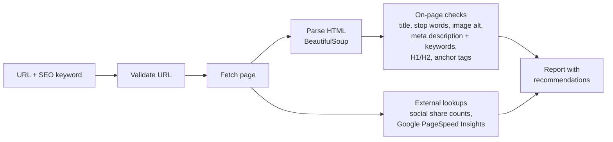

<p align="center"></p>

# SEO Analysis Tool

This is a Python script for analyzing the SEO (Search Engine Optimization) of a web page. It checks various on-page SEO factors and provides recommendations and information to help improve the website's SEO.

## How it works



## How to Use

1. Make sure you have Python installed on your system.

2. Install the required libraries by running the following command:

   ```bash
   pip install beautifulsoup4 requests validators

3. Save the stopwords.txt file in the same directory as the script. This file should contain a list of stop words to be used for analysis.

4. Run the script by executing it in your terminal or IDE.

5. You will be prompted to enter the URL of the web page you want to analyze. Make sure to enter the full URL, including the protocol (e.g., http:// or https://).

6. Enter the SEO keyword you want to analyze for.

7. The script will then perform various SEO analyses and provide you with the results.

# SEO Analyses Performed
- Title Length Analysis: Checks if the title length is within the recommended 60-character limit.

- Stop Words in Title Analysis: Identifies and counts stop words in the page title.

- Image Alt Text Analysis: Analyzes images on the page and checks for missing alt attributes and keyword presence in alt text.

- Metadata Description Analysis: Analyzes the meta description and checks its length and keyword presence.

- Metadata Keywords Analysis: Analyzes the meta keywords and checks for the presence of the specified keyword.

- H1 and H2 Analysis: Checks if the web page contains H1 and H2 tags.

- Anchor Tags Analysis: Analyzes anchor tags and checks for missing title attributes and generic anchor text.

- Social Media Impact Analysis: Fetches and displays Facebook share counts and Twitter tweet counts for the page.

- Google PageSpeed Insights Analysis: Checks the Google PageSpeed Insights score and provides additional insights and recommendations.

# Disclaimer
 - This script provides a basic analysis of SEO factors on a web page. It is not an exhaustive SEO tool and may not cover all SEO aspects. Use the results as a starting point for further optimization.

 - Please note that the effectiveness of SEO strategies may vary, and it's recommended to consult SEO experts and follow best practices for more comprehensive optimization.

Note: Make sure to comply with the website's terms of service and privacy policy when analyzing web pages.

## Responsible crawling

Use rate limits, respect robots guidance and site permissions, and review crawler output before acting on SEO recommendations.

## Visual assets

The banner illustration was generated from a written brief (`docs/assets/briefs/`, with the references it drew on); its sidecar `docs/assets/hero-art.png.json` records the prompt. Text is set in real type by `docs/assets/tools/compose_banner.py`. `docs/assets/social-preview.jpg` (1280x640) is for the repository's social preview.
